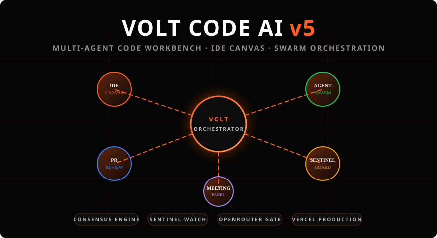

<div align="center">

<!-- Animated swarm hero — self-contained SVG, survives GitHub sanitization -->


<br/>

**VOLT CODE AI v5 — a multi-agent code workbench with a live Agent Swarm, IDE Canvas, and consensus-driven AI review.**

[](#)
[](#)
[](#)
[](https://volt-code-ai-v5-0.vercel.app)

[Live App](https://volt-code-ai-v5-0.vercel.app) • [Features](#-the-workbench) • [Architecture](#-architecture) • [Dev Setup](#-development) • [Security](#-security)

</div>

---

## 📐 Architecture

*Layered view of the runtime:*

```mermaid
graph TD
    classDef zTop  fill:#0d1117,stroke:#ff5f1f,stroke-width:2px,color:#fff,font-weight:bold;
    classDef zMid  fill:#161b22,stroke:#ff5f1f,stroke-width:1px,color:#ccd6f6;
    classDef zBase fill:#090d16,stroke:#30363d,stroke-width:1px,color:#8b949e,stroke-dasharray: 5 5;

    subgraph UI [🎛️ Workbench Surface]
        A["Editor · IDE Canvas · Agent Swarm View"]:::zTop
        B["Meeting Panel · PR Review · Vault Hub"]:::zTop
    end
    subgraph CORE [⚙️ Orchestration Core]
        C1["MultiAgentOrchestrator (Triage → Worker DAG → Self-correction)"):::zMid
        C2["ConsensusEngine (Senior Security / QA / UI / Architect)"):::zMid
        C3["SentinelWatcher · RepairPlanner · RecoveryCenter"]:::zMid
    end
    subgraph GATE [🚀 Serverless Gateway]
        D1["/api/openrouter — multi-provider AI gateway"]:::zBase
        D2["/api/models — live FREE/PAID availability"]:::zBase
        D3["/api/auth · /api/cloud · /api/database · secret vault"]:::zBase
    end

    A --> D1
    B --> D3
    C1 --> C2
    C1 --> D1
    C3 --> D3
```

---

## ⚡ The Workbench

| View | What it does |
| :--- | :--- |
| **Editor** | Paste code → `RUN AI ANALYSIS` → issue list with per-issue patch, FIX ALL, VisualDiff review. Live AGENT CHAT HUD on the side |
| **IDE Canvas** | Pro editing surface with inline agent suggestions (var→const, `===`, long lines) and the agent TODO widget |
| **Agent Swarm** | Live hub-and-spoke visualization of the orchestration: triage, workers, senior consensus — node scores populate during analysis |
| **Meeting Panel** | Agent group chat + audio interface + execution panel |
| **VOLT HUB** | Direct line to the AI core orchestrator (persisted across views) |
| **PR Review** | Repo PR triage dashboard |
| **GitHub Workspace** | Browse/work repos without leaving the bench |
| **Sentinel** | Continuous guard watch & audit trail |
| **Settings** | Provider keys (Groq / OpenRouter / NVIDIA / HF), model picker, **one-click workspace backup & restore** |

**Safety rails built in:** crash recovery boundary (backup + reload instead of a white screen), encrypted MongoDB secret vault, per-endpoint hardening, session persistence.

---

## 🌐 Multi-provider, free-tier friendly

Models are picked from a **live availability feed** (`/api/models`) — Groq, OpenRouter, NVIDIA NIM and HuggingFace are polled with your keys and only connected providers with FREE/PAID tiers are offered in the picker. Analysis even runs a **consensus vote**: Senior agents (Security, QA, UI, Architect) score the patch (`x/100`) and it's shown right next to your output.

---

## 💻 Development

```bash
npm install        # deps
npm run dev        # vite dev server
npm run build      # tsc -b && vite build
npm run test       # vitest — 10 suites
npm run lint       # eslint, 0-error policy
```

Stack: React 19 · TypeScript · Vite · Tailwind 4 · framer-motion · Vercel serverless · MongoDB.

Default branch: `main` → every merge auto-deploys to production via Vercel. Keep it to one branch: feature branches → PR → merge → delete.

---

## 🤝 Contributing / Security

Open a PR against `main` — the repo auto-lints, auto-checks secrets (Socket), and runs CodeQL on every push. Security findings? See `SECURITY.md`.

<div align="center">

[⭐ Star the repo](https://github.com/motherskitchenblr2/VOLT-CODE-AI-v5.0) • [🎨 Live demo](https://volt-code-ai-v5-0.vercel.app)

</div>
